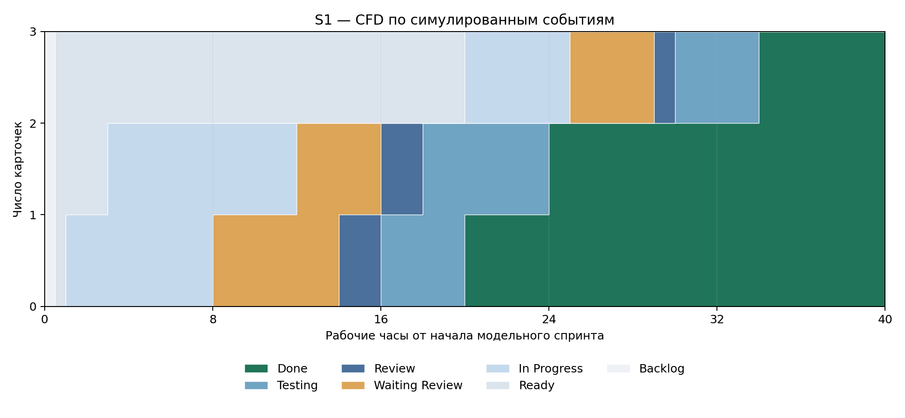
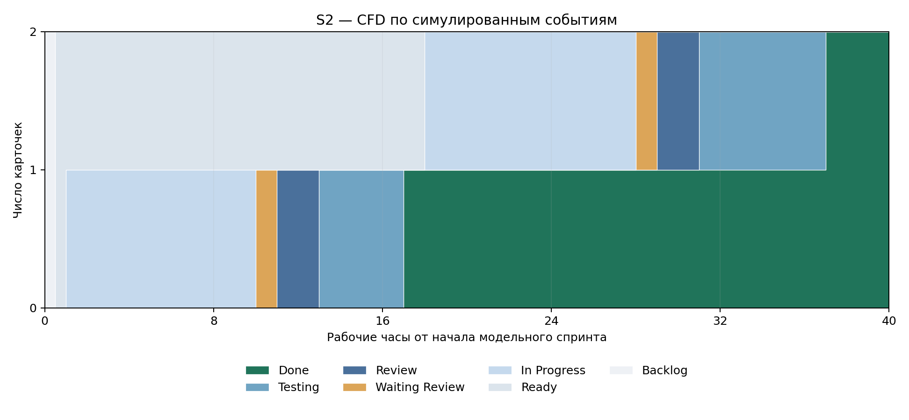

# ЛЗ 9 — пять историй версии 3

## Фактические действия
Созданы Issues #33–37 для CARD-13/14/17/19/20. Новое приложение размещено в CardioPrognoz_V3; корневой MVP сохраняется. Рабочие изменения после исходного архива: исправлена тестовая CSRF-фикстура; новые пароли хешируются Argon2id, старые Werkzeug-хеши обновляются после успешного входа; mock расширен до 20 разных синтетических записей. Реальная медицинская ИС не подключается.

## Приёмка
Исходный архив: 85 passed / 5 failed. После исправления фикстуры: 90 passed; первичный расширенный аудит: 115 passed. Финальные результаты находятся в evidence/published_version.* и GitHub Actions для этого PR. Проверены 20 разных JSON через реальный локальный HTTP, CSV 45/5, отзыв сеанса, Argon2id десяти новых аккаунтов и безопасное обновление старого хеша. Существующие аккаунты без успешного входа сохраняют прежний хеш; массовая миграция не объявляется выполненной.

## Политики и модель
Правила входа/выхода, DoR, DoD и WIP в PROCESS.md. В simulation/ отдельный журнал с source=simulation, без календарных дат; 3 истории S1 и 2 истории S2. Пересчёт: python -m pip install numpy matplotlib; python scripts/recalculate.py.

S1: throughput3, цикл18ч, p85 20.4ч, WIP1.35. S2: throughput2, цикл17.5ч, p85 18.55ч, WIP0.875. Дневной WIP взвешен по времени, p85 линейный; nearest-rank приведён отдельно. Единственное изменение модельного процесса — общий активный WIP≤1. Меньше ожидание ревью, но ниже throughput и больше время от Ready до Done; причинный эффект в реальной команде не утверждается.

## Границы
Независимое ревью и наблюдение двух реальных недель исключены владельцем из текущей работы. Полный строгий DoD и реальные переходы пяти карточек задним числом не объявляются. Карточки остаются открытыми. Снимок прежней доски относится к моменту до создания новых Issues и не изображает новое состояние.
