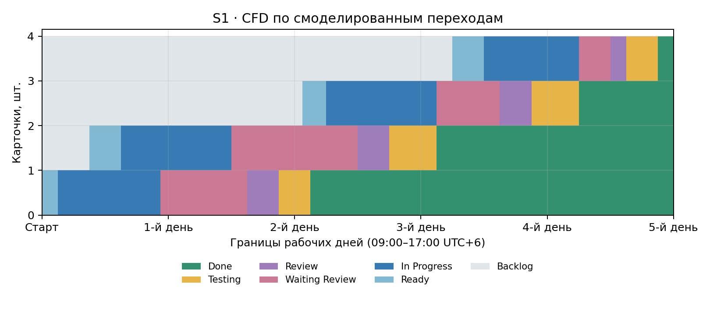
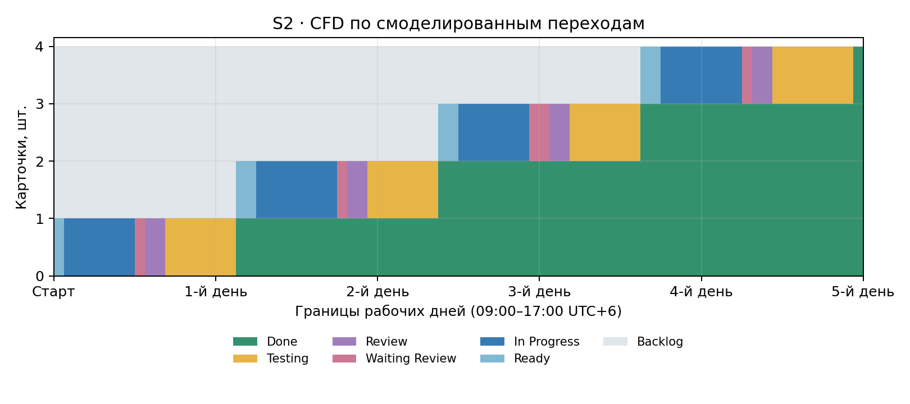

# ЛЗ 9 — двухнедельная симуляция спринтов

Проект «КардиоПрогноз». Восемь задач №14–21 реализованы и проверены, PR №23–30 объединены. Ниже представлен календарный сценарий двух спринтов по пять рабочих дней, согласованный с обновлённым Word-отчётом.

**Даты 9–20 ноября и метрики этого раздела относятся к модели.** Технические итерации подтверждены событиями GitHub от 7 ноября 2026 года. Исходные события доступны в [фактической выгрузке](evidence/), календарные переходы — в [модельном журнале](simulation/model_transitions.csv).

## Два спринта

| Спринт | Модельный период | Задачи | Результат для пользователя |
|---|---|---|---|
| S1 | 9–13 ноября 2026 | №14–17, PR №23–26 | Корректный прогноз при допустимом вводе и понятные сообщения при ошибках |
| S2 | 16–20 ноября 2026 | №18–21, PR №27–30 | Очистка формы, версия модели в ответе и понятное сообщение при недоступности XAI |

Каждый спринт занимает 40 рабочих часов, по 8 часов с 09:00 до 17:00 UTC+6. Ночи и выходные исключены из расчёта. В начале спринта в объёме находятся четыре задачи, каждая проходит Ready → In Progress → Waiting Review → Review → Testing → Done.

## Сравнение метрик модели

| Метрика | S1 | S2 |
|---|---:|---:|
| Длительность, рабочих дней | 5 | 5 |
| Throughput, задач за спринт | 4 | 4 |
| Интенсивность, задач за рабочий день | 0,8 | 0,8 |
| Средний cycle time, рабочих часов | 15,75 | 9,00 |
| p85 PERCENTILE, рабочих часов | 18,200 | 9,275 |
| p85 nearest-rank, рабочих часов | 20,0 | 9,5 |
| Средний активный WIP по времени | 1,575 | 0,900 |
| Средний WIP по пяти вечерним снимкам | 1,6 | 0,8 |
| Максимальный активный WIP | 2 | 1 |
| Рабочих часов с WIP > 1 | 25 | 0 |

Cycle time измеряется от первого In Progress до Done. Активный WIP включает In Progress, Waiting Review, Review и Testing. Средний WIP взвешен по длительности промежутков между событиями. Дневные средние и снимки на 17:00 показаны в [S1_daily.csv](simulation/S1_daily.csv) и [S2_daily.csv](simulation/S2_daily.csv).

p85 PERCENTILE использует линейную интерполяцию. При четырёх задачах позиция равна 3,55. Дополнительно приведён nearest-rank, который для такой выборки равен максимальному циклу. Полные расчёты находятся в [metrics.json](simulation/metrics.json).

## Проверка закона Литтла

В модели L = λ × W, где λ = 4 / 5 = 0,8 задачи за рабочий день, а W переводится из рабочих часов в дни делением на 8.

- S1 — L = 0,8 × (15,75 / 8) = **1,575** задачи.
- S2 — L = 0,8 × (9 / 8) = **0,900** задачи.

Проверка по площади WIP даёт соответственно 63 / 40 = 1,575 и 36 / 40 = 0,900. Начальный и конечный активный WIP равны нулю. Совпадение подтверждает согласованность модельного журнала и расчётов в пределах выбранного окна.

## Кумулятивные диаграммы потока

Графики построены по смоделированным переходам. Отметки на оси соответствуют концам рабочих дней, общая высота равна четырём задачам.

### S1 — 9–13 ноября



In Progress и Waiting Review расширяются до двух задач. На In Progress приходится 26,5 задачо-часа, на Waiting Review — 19,5. Во второй день две задачи одновременно ожидают ревью. Это места накопления в первом сценарии.

### S2 — 16–20 ноября



Суммарно в активных стадиях максимум одна задача. Waiting Review занимает 2,5 задачо-часа. Testing увеличивается с 10 до 14,5 задачо-часа. Ожидание до старта отражается в Backlog — 57 против 45,5 задачо-часа. Полная разбивка доступна в [S1_status_hours.csv](simulation/S1_status_hours.csv) и [S2_status_hours.csv](simulation/S2_status_hours.csv).

## Ретроспектива и одно изменение процесса

Модельное окно ретроспективы — 13 ноября, 17:00–17:30. Фактический асинхронный разбор опубликован в [Issue №17](https://github.com/Dororo345/ml-cardio-project/issues/17).

| Формат ретроспективы | Решение |
|---|---|
| Продолжать | Проверяемые критерии, негативные тесты и фиксацию переходов |
| Прекратить | Начинать новую задачу при наличии незавершённой активной задачи |
| Начать | Применить единый лимит активного WIP ≤ 1 |

**Единственное изменение S2 — общий активный WIP ≤ 1.** Владелец — исполнитель Dororo345. Срок в модели — с 16 ноября 09:00. Критерий успеха — максимум WIP не выше 1 и ноль рабочих часов с WIP > 1. В S2 критерий выполнен.

Средний цикл и средний WIP в модели сократились на 42,9 %, линейный p85 — на 49,0 %. Throughput остался равным четырём задачам за пять дней. Состав задач и заданные длительности различаются, поэтому результат описывает выбранный сценарий. Причинный эффект лимита в реальной команде требует наблюдения за сопоставимыми задачами.

## Доска GitHub Projects

[Доска проекта](https://github.com/users/Dororo345/projects/1/views/1) настроена и проверена 9 ноября 2026 года.

- Порядок колонок — Backlog, Ready, In Progress, Waiting Review, Review, Testing, Done.
- Лимиты колонок — In Progress 2, Waiting Review 2, Review 1, Testing 2.
- В Done находятся восемь карточек №14–21.
- В README проекта записаны политики входа и выхода, DoR, DoD и общий лимит S2.

История технических этапов сохранена в FLOW-комментариях и событиях закрытия Issues. Настройка доски выполнена после технических итераций.

## Фактические изменения и проверки

| Задача | Реализовано | Pull Request |
|---|---|---|
| [№14](https://github.com/Dororo345/ml-cardio-project/issues/14) | Контракт ошибок и валидация вероятности | [№23](https://github.com/Dororo345/ml-cardio-project/pull/23) |
| [№15](https://github.com/Dororo345/ml-cardio-project/issues/15) | Сообщения об ошибках полей формы | [№24](https://github.com/Dororo345/ml-cardio-project/pull/24) |
| [№16](https://github.com/Dororo345/ml-cardio-project/issues/16) | Python- и DOM-тесты в GitHub Actions | [№25](https://github.com/Dororo345/ml-cardio-project/pull/25) |
| [№17](https://github.com/Dororo345/ml-cardio-project/issues/17) | Сквозные HTTP-проверки 200/400/413 | [№26](https://github.com/Dororo345/ml-cardio-project/pull/26) |
| [№18](https://github.com/Dororo345/ml-cardio-project/issues/18) | Обработка недоступности XAI | [№27](https://github.com/Dororo345/ml-cardio-project/pull/27) |
| [№19](https://github.com/Dororo345/ml-cardio-project/issues/19) | Очистка формы и игнорирование позднего ответа | [№28](https://github.com/Dororo345/ml-cardio-project/pull/28) |
| [№20](https://github.com/Dororo345/ml-cardio-project/issues/20) | Версия модели и контроль SHA-256 | [№29](https://github.com/Dororo345/ml-cardio-project/pull/29) |
| [№21](https://github.com/Dororo345/ml-cardio-project/issues/21) | 50 синтетических HTTP-сценариев | [№30](https://github.com/Dororo345/ml-cardio-project/pull/30) |

Итог технической приёмки — 118 Python-тестов, 4 DOM-теста и матрица HTTP 50/50 (40 положительных, 10 негативных). Матрица также выполняется внутри одного pytest-теста. Ссылки на коммиты и CI сохранены в [реестре PR](evidence/verified_prs.json).

Независимое ревью вторым человеком остаётся неподтверждённым. В PR зафиксирована самопроверка. Проверки выполнялись на локальном стенде Flask/Werkzeug и в CI. DOM-тесты используют jsdom.

## Воспроизведение модели

Из корня репозитория, с установленным matplotlib, выполнить:

```bash
python -m pip install matplotlib
python docs/lz9/simulation/recalculate.py
```

Скрипт читает [model_transitions.csv](simulation/model_transitions.csv) и пересчитывает CSV циклов, времени в статусах, дневных значений, CFD и metrics.json. В модельных CSV указано source=simulation. Скрипт также проверяет порядок переходов, ограничения WIP и равенство площади WIP сумме циклов.

## Фактическая выгрузка GitHub

В [evidence/](evidence/) сохранены исходные данные и минутные метрики технических итераций от 7 ноября. Их можно воспроизвести отдельно:

```bash
python scripts/lz9/analyze_session.py --input docs/lz9/evidence/s1_raw.json --sprint S1 --out docs/lz9/evidence
python scripts/lz9/analyze_session.py --input docs/lz9/evidence/s2_raw.json --sprint S2 --out docs/lz9/evidence
```

Файлы s1_raw.json и s2_raw.json содержат выбранные поля API, включая URL, body, created_at, updated_at и closed_at. Фактические transitions.csv связывают переходы с комментариями GitHub. Для двухнедельного календаря используется каталог simulation/.

Проверки приложения после установки зависимостей из requirements.txt:

```bash
python -m pytest -q
npm ci
npm test
python scripts/lz9/synthetic_acceptance.py
```
